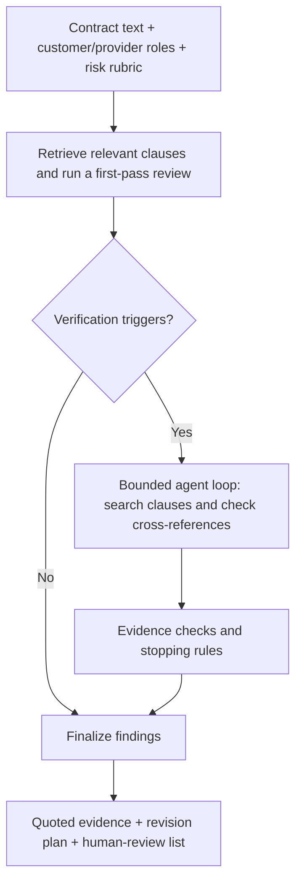

# Contract Review Agent — architecture

Team coursework by Jenny Yang and Kayla. Built for reviewing vendor service agreements against a defined risk rubric; not legal advice.

## What makes the loop bounded

- Code checks the first-pass output for issues such as low confidence, missing verdicts, or quote-check failures before starting follow-up verification.
- Step, no-progress, and cost limits prevent repeated searches from running indefinitely.
- The report shows the decision path, supporting quotes, model/tool calls, and cost so a reviewer can inspect what happened.

## How we checked it

Compared RAG, single-pass, and agent-loop variants on 11 held-out contracts across six clause families. We tracked verdict accuracy, false alarms, missed risks, and cost—not accuracy alone. The agent loop reached 70% verdict accuracy versus 50% for RAG, but the single-pass variant had fewer false alarms than the loop.

Human review is still a limitation: the model did not voluntarily invoke `ask_human` in the reported test; the six human-review referrals were rule-triggered.

[Run the local demo](https://github.com/JJJJeny/contract-review-agent#run-the-demo) · [Evaluation results](https://github.com/JJJJeny/contract-review-agent#results-at-a-glance) · [Agent implementation](https://github.com/JJJJeny/contract-review-agent/blob/main/notebooks/07_agent_v2_and_scoring.ipynb) · [Demo wrapper](https://github.com/JJJJeny/contract-review-agent/blob/main/demo_agent/agent.py)

The demo runs locally. Real model calls require credentials; the optional fake-model mode uses scripted responses.
